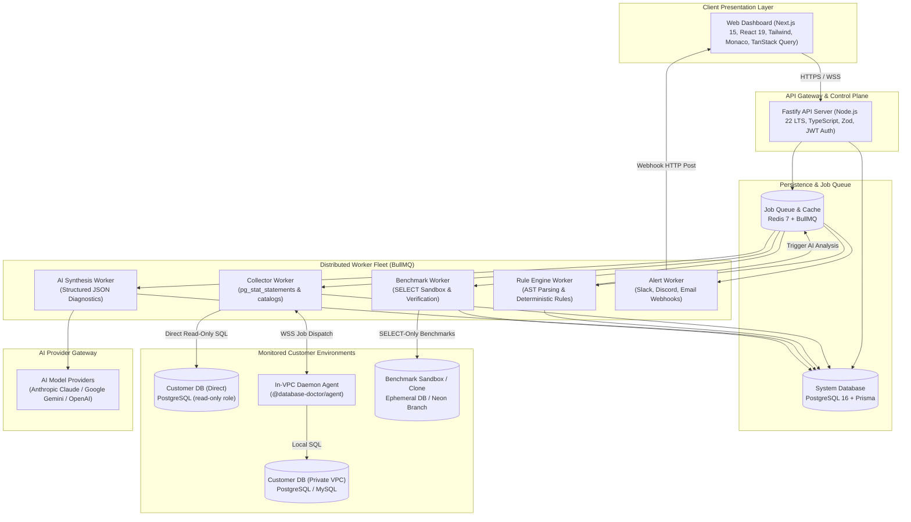
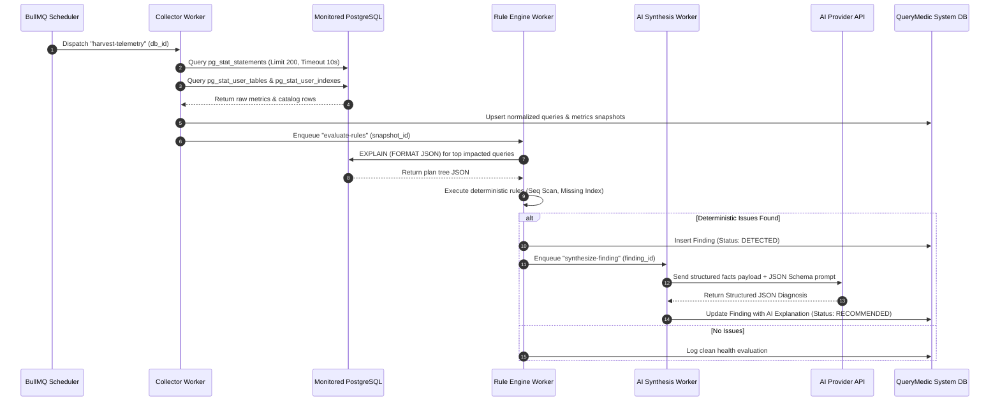
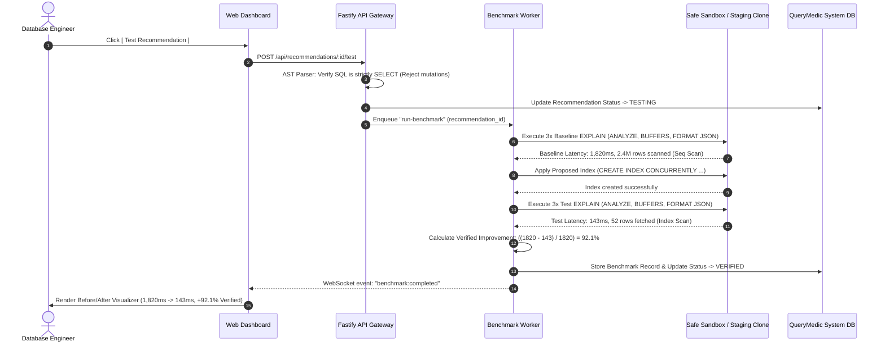
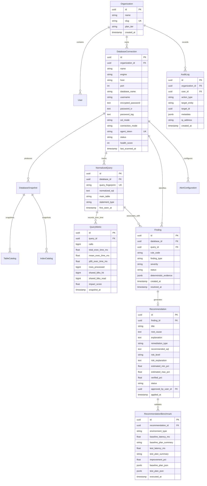
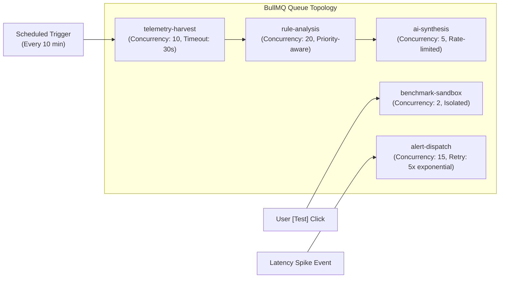

# 04. System Architecture & Technical Design

> **Document Status**: Complete & Authoritative  
> **Target Audience**: System Architects, Principal Engineers, Backend/Frontend Developers, DevOps/SRE  
> **System Name**: QueryMedic (`@database-doctor`)  
> **Companion Documents**:
> - [01_product_overview.md](file:///E:/Web_Development/QueryMedic%20—%20AI-powered%20database%20performance%20doctor/01_product_overview.md) — Product Vision & Business Positioning  
> - [02_domain_primer.md](file:///E:/Web_Development/QueryMedic%20—%20AI-powered%20database%20performance%20doctor/02_domain_primer.md) — Database Internals & Domain Concepts  
> - [03_requirements.md](file:///E:/Web_Development/QueryMedic%20—%20AI-powered%20database%20performance%20doctor/03_requirements.md) — Verifiable EARS Requirements Contract  
> - [05_project_tracking.md](file:///E:/Web_Development/QueryMedic%20—%20AI-powered%20database%20performance%20doctor/05_project_tracking.md) — Execution Roadmap & Milestone Tracking  

---

## 1. Architectural Goals & Non-Functional Requirements (NFRs)

```
┌────────────────────────────────────────────────────────────────────────────────────────┐
│                               Architectural Principles                                 │
├──────────────────────────┬──────────────────────────┬──────────────────────────────────┤
│ 1. Zero Production Risk  │ 2. Determinism First     │ 3. Strict Least Privilege        │
│ Never mutate live DBs;   │ Rules prove facts;       │ Enforce read-only roles and      │
│ sandboxed benchmarks     │ AI explains & synthesizes│ AES-256-GCM credential isolation│
└──────────────────────────┴──────────────────────────┴──────────────────────────────────┘
```

| Quality Attribute | Architectural Strategy | Quantitative Target |
| :--- | :--- | :--- |
| **Security at Rest** | Envelope encryption with AES-256-GCM for stored connection credentials; unique IV per ciphertext. | 0 plaintext credentials stored in database. |
| **Zero Sensitive Data Ingestion** | AST parameter scrubbing strips all SQL literals before storage; only normalized queries and catalog metadata are persisted. | 0 customer PII/row data stored. |
| **Target Database Overhead** | Collector queries run with strict session-level timeouts and batch limits; read-only roles only. | $< 1\%$ CPU overhead on monitored database. |
| **Asynchronous Decoupling** | All heavy workloads (collection, AST parsing, AI calls, benchmarking) are queued via Redis 7 + BullMQ. | HTTP API response times $< 80\text{ ms}$ (P95). |
| **Provider Pluggability** | Engine adapters (`DatabaseAdapter`) and AI providers (`AIProvider`) use TypeScript abstract interfaces. | Adding new DB (MySQL) or LLM requires 0 changes to core domain logic. |
| **Verification Credibility** | Benchmarks distinguish mathematical planner estimates from empirically executed tests in isolated sandboxes. | 100% of benchmark claims validated via `EXPLAIN (ANALYZE, BUFFERS)`. |

---

## 2. System Component Topology

The system uses a domain-driven monorepo architecture separating the **Web Dashboard**, the **API Gateway Server**, **Asynchronous Background Workers**, the **AI Gateway**, and an optional **In-VPC Daemon Agent**.



---

## 3. Core Subsystems & Domain Modules

### 3.1 API Server & Domain Organization (`apps/api`)
The API server is structured into high-cohesion domain modules rather than technical layers:

```
apps/api/src/modules/
├── auth/                 # JWT issuing, session validation, password hashing
├── organizations/        # Multi-tenant isolation, members, role bindings (RBAC)
├── databases/            # Connection manager, AES-256 vault, health checks
├── telemetry/            # Ingestion endpoints, snapshot scheduler
├── queries/              # Query explorer, AST normalizer, fingerprint registry
├── analysis/             # Deterministic rule engine triggers, findings manager
├── recommendations/      # Recommendation state machine, candidate DDL generator
├── benchmarks/           # SELECT-only benchmark sandbox runner, before/after metrics
├── alerts/               # Latency regression detector, webhook dispatchers
└── audit/                # Immutable audit log recorder
```

### 3.2 Target Database Adapter Abstraction (`packages/db-adapters`)
To support PostgreSQL first and seamlessly introduce MySQL 8.0+ without refactoring, all target interactions implement a common contract:

```typescript
export interface ExecutionPlanNode {
  nodeType: string;
  relationName?: string;
  totalCost: number;
  planRows: number;
  actualRows?: number;
  actualDurationMs?: number;
  filter?: string;
  rowsRemovedByFilter?: number;
  children?: ExecutionPlanNode[];
}

export interface DatabaseAdapter {
  testConnection(): Promise<{ ok: boolean; latencyMs: number; version: string }>;
  verifyPermissions(): Promise<{ hasStatStatements: boolean; isReadOnly: boolean; warnings: string[] }>;
  collectQueryStatistics(limit: number): Promise<RawQueryStatistic[]>;
  collectTableCatalogs(): Promise<TableCatalogMetric[]>;
  collectIndexCatalogs(): Promise<IndexCatalogMetric[]>;
  collectHealthVitals(): Promise<DatabaseHealthVitals>;
  explainQuery(sql: string, params?: unknown[]): Promise<ExecutionPlanNode>;
  explainAnalyzeBenchmark(sql: string, params?: unknown[]): Promise<BenchmarkRunResult>;
  executeTemporaryDDL?(ddl: string): Promise<void>;
}
```

### 3.3 AI Layer Abstraction (`packages/ai-engine`)
The AI engine decouples LLM vendor APIs from QueryMedic's core logic:

```typescript
export interface AIProvider {
  name: 'anthropic' | 'gemini' | 'openai' | 'local';
  diagnoseFinding(input: FindingDiagnosticInput): Promise<StructuredDiagnosis>;
  explainQueryPlan(input: PlanExplanationInput): Promise<PlanExplanation>;
  explainCapacityTrend(input: CapacityTrendInput): Promise<CapacityExplanation>;
}
```

The payload sent to `diagnoseFinding` contains **strictly structured facts**:
1. Normalized SQL text (parameter literals stripped).
2. Table metadata (total row count, total relation bytes, dead tuple percentage).
3. Existing index definitions on the target relation.
4. Parsed JSON execution plan tree nodes.
5. Triggered deterministic rule IDs (e.g., `RULE-SCAN-01`, `RULE-IDX-01`).

The response is strictly parsed and verified via **Zod**:

```typescript
export const StructuredDiagnosisSchema = z.object({
  title: z.string().min(5),
  severity: z.enum(['CRITICAL', 'HIGH', 'MEDIUM', 'LOW']),
  rootCause: z.string().min(20),
  explanation: z.string().min(30),
  remediationType: z.enum(['CREATE_INDEX', 'DROP_INDEX', 'REWRITE_QUERY', 'VACUUM', 'CONFIG_CHANGE']),
  recommendedSql: z.string(),
  riskLevel: z.enum(['LOW', 'MEDIUM', 'HIGH']),
  riskExplanation: z.string(),
  estimatedImprovementPct: z.object({
    min: z.number().min(0).max(100),
    max: z.number().min(0).max(100),
  }),
  confidenceScore: z.number().min(0).max(1),
});
```

---

## 4. End-to-End Data Flows & Sequence Diagrams

### 4.1 Telemetry Harvesting & Problem Detection Sequence



### 4.2 Safe Verification & Benchmarking Sandbox Sequence



---

## 5. System Relational Data Model (System DB)

The QueryMedic management database uses PostgreSQL with Prisma ORM.



---

## 6. Security & Cryptographic Architecture

### 6.1 Envelope Encryption for Target Credentials
All passwords and database URIs are encrypted using authenticated **AES-256-GCM** before persistence:
- **Master Encryption Key (MEK)**: A 256-bit cryptographically secure key supplied via environment variable or cloud KMS (AWS KMS / HashiCorp Vault).
- **Initialization Vector (IV)**: A unique, cryptographically random 96-bit IV generated per encryption operation.
- **Authentication Tag**: A 128-bit GCM authentication tag verifying ciphertext integrity and detecting tampering.

```
Plaintext Password + Master Key + Random IV (12 bytes)
           │
           ▼
[ AES-256-GCM Encryption ]
           │
           ├── Ciphertext (Base64)
           ├── IV (Base64)
           └── Auth Tag (Base64)
           │
           ▼
Stored in database_connections table
```

### 6.2 AST Scrubbing & Privacy Boundary
Application code never stores real query parameters:
1. When telemetry is harvested, PostgreSQL's `pg_stat_statements` natively parameterizes constants into `$1, $2`.
2. When the user pastes custom SQL or queries are captured via the agent, a client-side SQL parser walks the AST and substitutes string literals, numbers, and UUIDs with `?`.
3. Customer row data is **never** queried or persisted; only execution metadata (`calls`, `mean_exec_time`, `rows`, buffer counts) is stored.

---

## 7. Distributed Queue Topology (BullMQ + Redis 7)



| Queue Name | Primary Responsibility | Concurrency | Retry Policy | Timeout |
| :--- | :--- | :--- | :--- | :--- |
| `telemetry-harvest` | Polls target DBs for statistics & snapshots | 10 | 2 retries, 10s delay | 30 seconds |
| `rule-analysis` | Computes Impact Scores, runs deterministic rules | 20 | 3 retries, 5s delay | 60 seconds |
| `ai-synthesis` | Calls LLM API with structured schemas | 5 | 3 retries, exponential backoff | 45 seconds |
| `benchmark-sandbox` | Executes safe SELECT benchmarks in test DB | 2 | 0 retries (fail fast) | 90 seconds |
| `alert-dispatch` | Sends notifications to Slack/Discord/Webhooks | 15 | 5 retries, exponential backoff | 15 seconds |

---

## 8. Technology Stack Manifest

```
┌────────────────────────────────────────────────────────────────────────┐
│                        QueryMedic Technology Stack                     │
├─────────────────────┬────────────────────┬─────────────────────────────┤
│ Component           │ Technology         │ Rationale                   │
├─────────────────────┼────────────────────┼─────────────────────────────┤
│ Frontend Framework  │ Next.js 15 (App R) │ Fast SSR, Server Actions    │
│ Frontend UI         │ Tailwind + shadcn  │ High aesthetic velocity     │
│ State & Querying    │ TanStack Query v5  │ Seamless cache invalidation │
│ SQL Editor          │ Monaco Editor      │ Rich SQL IDE experience     │
│ Charting            │ Recharts           │ Responsive SVG performance  │
├─────────────────────┼────────────────────┼─────────────────────────────┤
│ API Server          │ Fastify + Node 22  │ High throughput, low latency│
│ Language            │ TypeScript 5.6     │ End-to-end type safety      │
│ Validation          │ Zod                │ Runtime schema enforcement  │
│ System Database     │ PostgreSQL 16      │ Robust relational storage   │
│ ORM                 │ Prisma             │ Type-safe migrations        │
│ Queue & Cache       │ Redis 7 + BullMQ   │ Robust distributed tasks    │
├─────────────────────┼────────────────────┼─────────────────────────────┤
│ Target DB Drivers   │ pg (node-postgres) │ Battle-tested PostgreSQL    │
│ SQL Parser          │ node-sql-parser    │ AST inspection & scrubbing  │
│ AI Providers        │ Anthropic / Gemini │ Structured JSON synthesis   │
└─────────────────────┴────────────────────┴─────────────────────────────┘
```

---

## 9. Monorepo Repository Structure

```
query-medic/
├── apps/
│   ├── web/                    # Next.js 15 Frontend Dashboard
│   │   ├── src/app/            # App Router pages (auth, dashboard, queries, recommendations)
│   │   ├── src/components/     # UI components (MonacoEditor, PlanVisualizer, HealthGauge)
│   │   └── src/hooks/          # TanStack Query custom hooks
│   ├── api/                    # Fastify API Server
│   │   ├── src/modules/        # Domain modules (auth, databases, analysis, etc.)
│   │   ├── src/plugins/        # Fastify plugins (JWT, CORS, Swagger, BullMQ)
│   │   └── src/server.ts       # Server entrypoint
│   └── workers/                # BullMQ Worker Fleet
│       ├── src/processors/     # Telemetry, Rule, AI, Benchmark, and Alert processors
│       └── src/worker.ts       # Worker process entrypoint
├── packages/
│   ├── db-adapters/            # PostgreSQL & MySQL adapter implementations
│   ├── rule-engine/            # Deterministic detection rules & AST analyzers
│   ├── ai-engine/              # LLM provider abstraction & structured Zod schemas
│   ├── security/               # AES-256-GCM encryption & parameter scrubbers
│   └── database/               # Shared Prisma schema, client, and migrations
├── docker/
│   ├── docker-compose.yml      # Local dev stack (API, Web, Redis, Postgres, Sample DB)
│   └── Dockerfile.agent        # In-VPC Daemon Agent container
├── package.json
└── tsconfig.base.json
```
